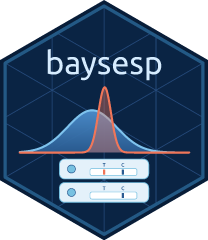

# baysesp 

<!-- badges: start -->
[](https://lifecycle.r-lib.org/articles/stages.html#experimental)
<!-- badges: end -->

`{baysesp}` provides Bayesian estimation of the accuracy (sensitivity,
specificity and predictive values) of one or more binary diagnostic tests
performed on the same subjects, when the disease status is ascertained by
the reference standard only for a subset of them (*partial verification*).

Estimating accuracy from the verified subjects alone is biased whenever the
decision to verify depends on the test results, as it usually does in
screening studies. `{baysesp}` corrects this *verification bias* with a joint
model for the tests, the disease and the verification process, written in
[Stan](https://mc-stan.org).

## Planned features

- Joint modelling of **K binary tests**, with or without conditional
  dependence between them.
- Accuracy of **combination rules**: any test positive, all positive,
  at least *k* positive.
- **Comparisons between tests**: differences and ratios of sensitivities
  and specificities, with their posterior distributions.
- **Ignorable and non-ignorable verification**, with explicit sensitivity
  analyses for the quantities that the data cannot identify, such as the
  prevalence among subjects who are never verified.
- Two Stan backends: `{rstan}` (default, models precompiled at
  installation) and `{cmdstanr}` (optional).

## Status

The package is under active development and its interface is not stable
yet. The modelling framework is being implemented step by step.

## Installation

You can install the development version of `{baysesp}` from
[GitHub](https://github.com/giovannitinervia9/baysesp) with:

``` r
# install.packages("remotes")
remotes::install_github("giovannitinervia9/baysesp")
```

Installing the package compiles its Stan models and takes a few minutes.

To use the optional `{cmdstanr}` backend, install
[`{cmdstanr}` and CmdStan](https://mc-stan.org/cmdstanr/) and compile the
models once with `compile_models()`:

``` r
baysesp::compile_models()
```
