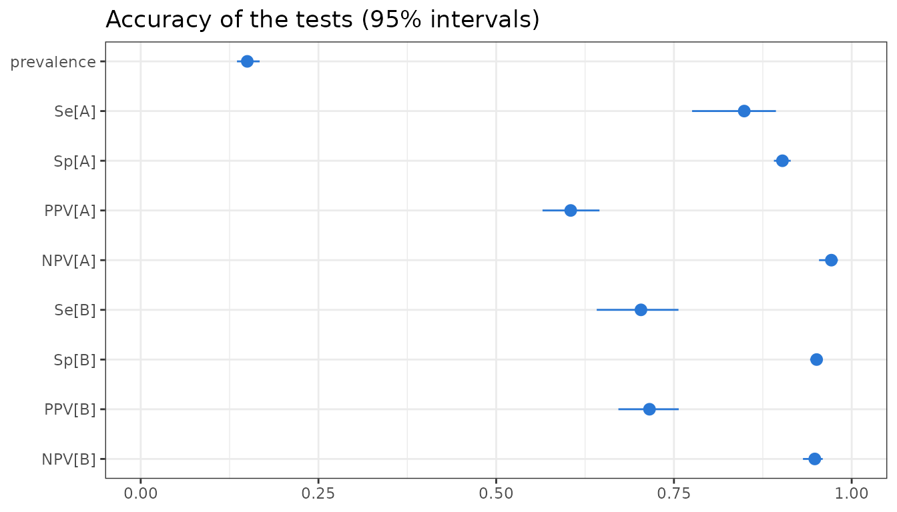
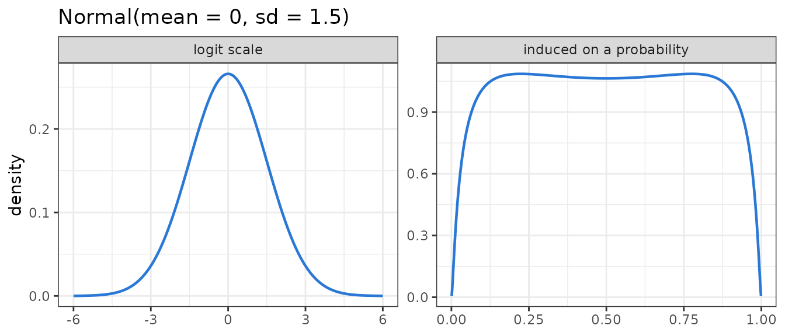
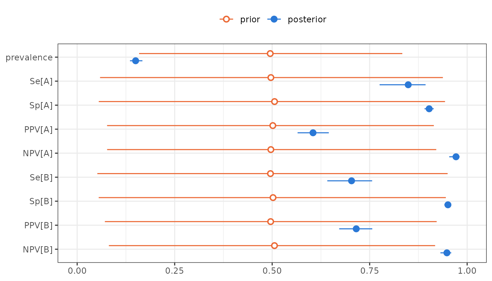
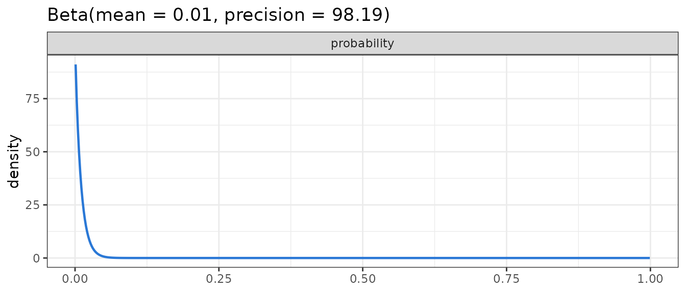
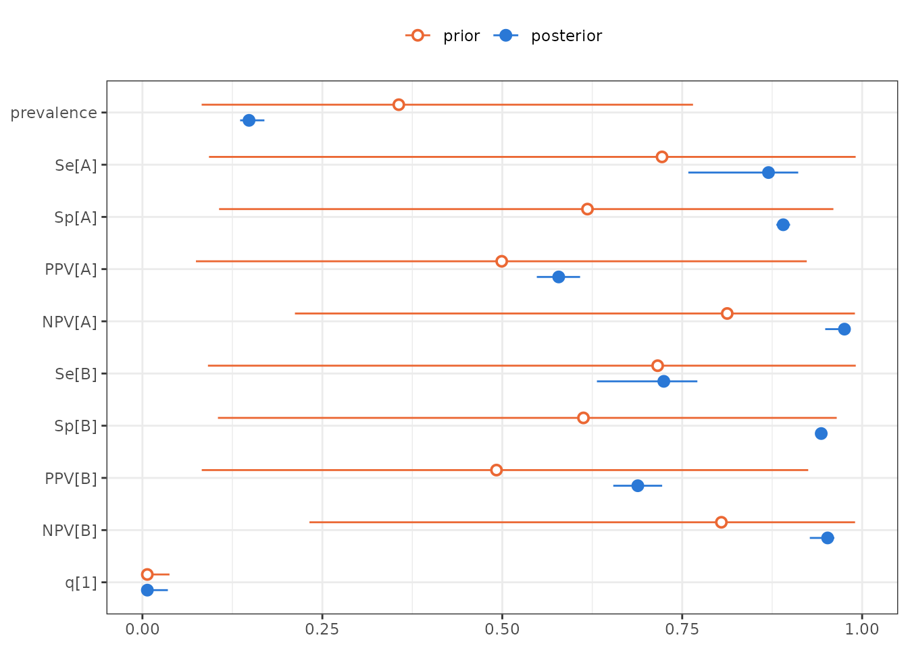
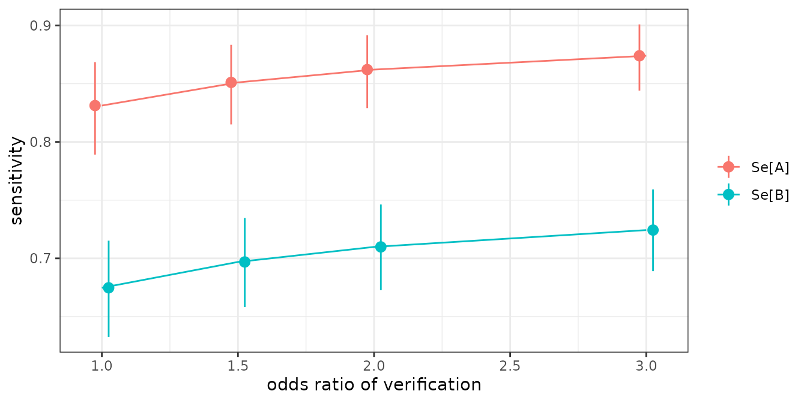

# Using baysesp

## 1. What the package does

In a diagnostic accuracy study, every subject receives one or more
tests, and the *reference standard*—the definitive procedure
establishing true disease status—should ideally be applied to all
subjects. Because it is often invasive or expensive, only some are
verified, usually more often those with positive tests. Because positive
tests are over-represented among the verified, computing *sensitivity*
(how often diseased subjects test positive) and *specificity* (how often
healthy subjects test negative) from verified subjects alone distorts
both estimates: this is *verification bias*.

[baysesp](https://github.com/giovannitinervia9/baysesp) corrects for
verification bias when estimating sensitivity, specificity, and
*predictive values* (disease or health probabilities given a test
result) of binary tests and combined rules. It models all
subjects—verified or not—in a Bayesian model fitted with Stan, sampling
parameters from their *posterior distributions* (combining priors with
data). For every subject, you need all test results, verification
status, and, if verified, disease status.

The shortest analysis takes three steps—preparing data, fitting the
model, and reading accuracy—as previewed below (not evaluated before
`study` exists):

``` r

library(baysesp)
d <- baysesp_data(data = study, tests = c("A", "B"), verified = "verified",
                  disease = "disease")
fit <- baysesp(data = d)
test_accuracy(fit = fit)
```

After [`library(baysesp)`](https://github.com/giovannitinervia9/baysesp)
loads [baysesp](https://github.com/giovannitinervia9/baysesp),
[`baysesp_data()`](https://giovannitinervia9.github.io/baysesp/reference/baysesp_data.md)
summarizes the data into `d`,
[`baysesp()`](https://giovannitinervia9.github.io/baysesp/reference/baysesp.md)
fits the model using `data = d` to produce `fit`, and
[`test_accuracy()`](https://giovannitinervia9.github.io/baysesp/reference/test_accuracy.md)
extracts accuracy estimates from `fit = fit`.

The rest of the vignette explains each step, its choices, and how to
read the results, following one simulated population through harder
verification designs so each estimate can be compared with the truth:

- [Section 2](#data): preparing the data, and two questions before
  fitting;
- Sections [3](#fitting) to [6](#rules): a study where every test
  combination has verified subjects: fitting, sampler checks, priors,
  combining and comparing tests;
- [Section 7](#never-verified): combinations of results that are never
  verified;
- [Section 8](#mnar): verification that depends on the disease;
- [Section 9](#structured): models assuming how the tests depend on each
  other;

First, we load [baysesp](https://github.com/giovannitinervia9/baysesp)
for the walkthrough:

``` r

library(baysesp)
```

Loading [baysesp](https://github.com/giovannitinervia9/baysesp) prints
nothing; next, [Section 2](#data) simulates our study and prepares the
data.

## 2. Preparing the data

### A simulated study

To see how [baysesp](https://github.com/giovannitinervia9/baysesp)
performs when true accuracy is known, we simulate a diagnostic study of
`n = 3000` subjects with
[`simulate_study()`](https://giovannitinervia9.github.io/baysesp/reference/simulate_study.md).
In this population—used throughout the vignette—15%
(`prevalence = 0.15`) are diseased, and two binary tests, `A` and `B`,
have sensitivities 0.85 and 0.70 and specificities 0.90 and 0.95, with
only some subjects verified. After setting the seed, we simulate `study`
and inspect its first 6 rows with `head(study)`:

``` r

set.seed(2026)
study <- simulate_study(
  n = 3000,
  prevalence = 0.15,
  sensitivity = c(A = 0.85, B = 0.70),
  specificity = c(A = 0.90, B = 0.95),
  verification_prob = c(0.1, 0.8, 0.8, 1),
  odds_ratio = 1,
  dependence = independence()
)
head(study)
#>   A B verified disease
#> 1 0 0        0      NA
#> 2 1 0        1       0
#> 3 0 0        0      NA
#> 4 0 0        1       0
#> 5 0 1        1       0
#> 6 0 0        0      NA
```

- `n`: number of subjects;
- `prevalence`: probability that a subject is diseased;
- `sensitivity`: sensitivity of each test (probability that a diseased
  subject tests positive); its names (`A`, `B`) name the test columns;
- `specificity`: specificity of each test (probability that a healthy
  subject tests negative);
- `verification_prob`: verification probability for each test-result
  combination in the order explained [below](#profiles): 0.1 when both
  tests are negative, 0.8 when one is positive, and 1 when both are
  positive;
- `odds_ratio`: ratio of verification odds between diseased and healthy
  subjects with the same test results; the default, `odds_ratio = 1`,
  means verification depends only on the test results ([Section
  8](#mnar) uses another value);
- `dependence`: how tests depend on each other given disease status;
  `dependence = independence()` (default) assumes *conditional
  independence*, while `dependence = latent_dependence()` and
  `dependence = probit_dependence()` allow dependence ([Section
  9](#structured)).

In `head(study)`, each row is one subject with test results `A` and `B`
(1 positive, 0 negative), `verified` (1 yes, 0 no), and `disease` (1
diseased, 0 healthy). Rows 1, 3, and 6 are unverified (`verified` is 0),
so `disease` is `NA`, while rows 2, 4, and 5 are verified healthy
subjects (`disease` is 0).

### From individual data to profiles

Next,
[`baysesp_data()`](https://giovannitinervia9.github.io/baysesp/reference/baysesp_data.md)
validates the columns of `study` and aggregates its individual rows into
summary counts stored in `d`:

``` r

d <- baysesp_data(
  data = study,
  tests = c("A", "B"),
  verified = "verified",
  disease = "disease",
  counts = NULL
)
d
#> <baysesp_data> 2 tests, 4 profiles, 3000 subjects, 911 verified
#> never-verified profiles: none
#> 
#>  A B diseased healthy unverified
#>  0 0        1     210       1996
#>  1 0       92     194         66
#>  0 1       41      97         27
#>  1 1      267       9          0
```

- `data`: a data frame, by default with one row per subject;
- `tests`: column names for the test results, coded 0/1 or logical (1
  positive);
- `verified`: column name indicating verification (1 verified, 0 not);
- `disease`: column name for disease status (1 diseased, 0 healthy, `NA`
  if unverified);
- `counts`: for aggregated data, the column name with subject counts;
  the default, `counts = NULL`, assumes one row per subject.

Printing `d` shows the header
`2 tests, 4 profiles, 3000 subjects, 911 verified` and
`never-verified profiles: none`, followed by the profile table. Each row
is a *response profile*—a combination of test results—with counts of
verified `diseased`, verified `healthy`, and `unverified` subjects. With
`K` tests there are `2^K` profiles, ordered with all tests negative
first and the first test changing fastest: `(0,0)` (1 diseased, 210
healthy, 1996 unverified), `(1,0)` (92, 194, 66), `(0,1)` (41, 97, 27),
and `(1,1)` (267, 9, 0). Every argument taking one value per profile,
such as `verification_prob`, follows this order.

The summary loses no information: the likelihood (probability of the
observed data given the parameters) depends on the data only through
these counts.

### Aggregated data

Published studies usually report a table of counts rather than
individual rows. Instead of expanding them back into 3000 rows, enter
one row per combination of test results, verification, and disease
status with a count column, and pass its name to `counts`. Below, we
build `published` from the counts of `study` and pass `counts = "n"` to
[`baysesp_data()`](https://giovannitinervia9.github.io/baysesp/reference/baysesp_data.md):

``` r

published <- data.frame(
  A        = c(0, 0, 0, 1, 1, 1, 0, 0, 0, 1, 1),
  B        = c(0, 0, 0, 0, 0, 0, 1, 1, 1, 1, 1),
  verified = c(1, 1, 0, 1, 1, 0, 1, 1, 0, 1, 1),
  disease  = c(1, 0, NA, 1, 0, NA, 1, 0, NA, 1, 0),
  n        = c(1, 210, 1996, 92, 194, 66, 41, 97, 27, 267, 9)
)
baysesp_data(
  data = published,
  tests = c("A", "B"),
  verified = "verified",
  disease = "disease",
  counts = "n"
)
#> <baysesp_data> 2 tests, 4 profiles, 3000 subjects, 911 verified
#> never-verified profiles: none
#> 
#>  A B diseased healthy unverified
#>  0 0        1     210       1996
#>  1 0       92     194         66
#>  0 1       41      97         27
#>  1 1      267       9          0
```

Every count and header line matches `d` identically. Notice that
`published` omits the unverified `(1,1)` row because it has 0 subjects:
rows with zero subjects can always be left out.

### Checks before fitting

Once
[`baysesp_data()`](https://giovannitinervia9.github.io/baysesp/reference/baysesp_data.md)
summarizes the data, two questions determine the model assumptions
needed next.

First, *does every profile have some verified subjects?* The printed
`never-verified profiles:` line answers this directly: here it says
`none`, meaning every profile has verified subjects. If any profile has
none, the counts give no direct information on how many diseased
subjects it holds, so an explicit assumption is needed ([Section
7](#never-verified)).

Second, *could verification depend on the disease, beyond the test
results?* This depends on how the study was run rather than the counts
alone. If only the test results guided verification, the answer is no;
if symptoms or subjects’ willingness also mattered, verification may
depend on disease status even within a profile, and the answer may be
yes ([Section 8](#mnar)).

In `study`, every profile has verified subjects and verification depends
only on test results (`odds_ratio = 1`), the simplest setting analyzed
in Sections [3](#fitting) to [6](#rules), starting in [Section
3](#fitting).

## 3. Fitting the model

In `study`, every profile has verified subjects and verification depends
only on the test results, so we can start with the simplest model.
Before fitting it to `d`, however, let us see what happens if we ignore
unverified subjects and compute the sensitivity of `A` on
`verified == 1` alone:

``` r

verified <- study[study$verified == 1, ]
mean(verified$A[verified$disease == 1])
#> [1] 0.8952618
```

The naive estimate, 0.895, is well above the true sensitivity 0.85. This
upward bias occurs because diseased subjects missed by both tests are
verified with probability 0.1 instead of 0.8 or 1, leaving verified
diseased subjects disproportionately positive on `A`.

To correct this bias using both verified and unverified counts in `d`,
we fit the Bayesian model with
[`baysesp()`](https://giovannitinervia9.github.io/baysesp/reference/baysesp.md)
and store the result in `fit`:

``` r

fit <- baysesp(
  data = d,
  model = saturated(verification = mar()),
  backend = "rstan",
  chains = 4,
  iter_warmup = 1000,
  iter_sampling = 1000,
  seed = 1
)
```

- `data`: the data object prepared by
  [`baysesp_data()`](https://giovannitinervia9.github.io/baysesp/reference/baysesp_data.md);
- `model`: the model, setting the priors and the verification
  assumption;
  [`saturated()`](https://giovannitinervia9.github.io/baysesp/reference/saturated.md)
  makes no assumption on how tests depend on each other given disease
  status, and `verification = mar()` (*missing at random*) assumes
  verification depends only on test results
  (`model = saturated(verification = mar())` is the default);
- `backend`: the Stan interface used to run the sampler, either
  `"rstan"` (the default, which uses the Stan programs compiled when
  [baysesp](https://github.com/giovannitinervia9/baysesp) is installed)
  or `"cmdstanr"` (which needs `{cmdstanr}` and CmdStan, and compiles
  the programs at first use);
- `chains`: the number of independent Markov chains (default 4);
- `iter_warmup`: the number of warmup iterations per chain used to tune
  the sampler and discarded (default 1000);
- `iter_sampling`: the number of sampling iterations per chain kept for
  inference (default 1000);
- `seed`: the random seed (1 here, the only non-default argument in this
  call, so `baysesp(data = d, seed = 1)` gives the same fit) for
  reproducible results.

[`baysesp()`](https://giovannitinervia9.github.io/baysesp/reference/baysesp.md)
returns the fitted model without printing anything. Printing `fit` shows
the model, the sampler diagnostics and the estimates:

``` r

fit
#> <baysesp_fit> saturated model, MAR verification, 4 chains x 1000 draws (rstan)
#> Convergence: max R-hat 1.004, min bulk ESS 4124, min tail ESS 2138, 0 divergent transitions
#> 
#>    quantity  mean median lower upper identified
#>  prevalence 0.150  0.150 0.135 0.167       TRUE
#>       Se[A] 0.845  0.849 0.775 0.893       TRUE
#>       Sp[A] 0.902  0.903 0.891 0.914       TRUE
#>      PPV[A] 0.605  0.605 0.565 0.645       TRUE
#>      NPV[A] 0.970  0.971 0.954 0.981       TRUE
#>       Se[B] 0.703  0.704 0.641 0.756       TRUE
#>       Sp[B] 0.951  0.951 0.941 0.959       TRUE
#>      PPV[B] 0.715  0.716 0.672 0.757       TRUE
#>      NPV[B] 0.947  0.948 0.931 0.959       TRUE
#> 
#> Odds ratio of verification fixed at 1 (MAR).
```

Four parts appear in the output. First, the header line summarizes the
fit: a `saturated` model, `MAR` verification, 4 chains of 1000 draws
each, and the `"rstan"` backend.

Second, because
[`baysesp()`](https://giovannitinervia9.github.io/baysesp/reference/baysesp.md)
uses Markov chain Monte Carlo (MCMC) to draw samples from the posterior
distribution, the `Convergence:` line checks whether the chains
converged, reporting the worst diagnostic across all parameters: largest
R-hat 1.004 (measuring agreement across chains; values below 1.01
indicate good mixing), smallest bulk and tail effective sample sizes
5602 and 2433 (effectively independent draws in the center and tails of
the posterior; values above a few hundred are desirable), and 0
divergent transitions (a nonzero count warns of numerical sampling
trouble). All four checks look healthy; [Section 4](#sampler) shows how
to inspect diagnostics per parameter and tune the sampler if needed.

Third, the table gives one row per accuracy quantity:

- `prevalence`: the proportion of diseased subjects in the population;
- `Se[A]`, `Sp[A]`: sensitivity and specificity of test `A`—the
  probabilities that a diseased subject tests positive and a healthy
  subject tests negative—followed by `Se[B]` and `Sp[B]` for test `B`;
- `PPV[A]`, `NPV[A]`: positive and negative predictive values of test
  `A`—the probabilities that a positive subject is diseased and a
  negative subject is healthy—followed by `PPV[B]` and `NPV[B]`; unlike
  sensitivity and specificity, predictive values depend on prevalence
  and hold only for populations with the same prevalence.

The columns report the `quantity` name, the posterior `mean` and
`median`, the `lower` and `upper` limits of the 95% credible interval
(containing the quantity with 95% posterior probability), and
`identified`. Here `identified` is `TRUE` for every row—meaning each
quantity is *identified* (estimated from the data, so its interval
shrinks around the true value with more data)—because every profile has
verified subjects under MAR. The posterior means (0.150 prevalence,
0.845 and 0.703 sensitivities, 0.902 and 0.951 specificities) closely
recover the simulation truth (0.15, 0.85, 0.70, 0.90, 0.95).

Fourth, the closing line states that the odds ratio of verification is
fixed at 1 under MAR (diseased and healthy subjects with the same test
results have equal odds of verification). Under *missing not at random*
(MNAR) verification, this odds ratio is estimated instead and appears as
an `odds_ratio` row in the table ([Section 8](#mnar)).

To obtain the same summary table as a data frame—for further
computations or to change the credible level—call
[`test_accuracy()`](https://giovannitinervia9.github.io/baysesp/reference/test_accuracy.md):

``` r

test_accuracy(fit = fit, level = 0.95)
#>     quantity      mean    median     lower     upper identified
#> 1 prevalence 0.1502432 0.1498875 0.1354257 0.1672890       TRUE
#> 2      Se[A] 0.8446544 0.8488566 0.7754855 0.8934065       TRUE
#> 3      Sp[A] 0.9024739 0.9025993 0.8906182 0.9142404       TRUE
#> 4     PPV[A] 0.6047388 0.6047673 0.5651597 0.6452495       TRUE
#> 5     NPV[A] 0.9703282 0.9713977 0.9540481 0.9805913       TRUE
#> 6      Se[B] 0.7025317 0.7035913 0.6413860 0.7563585       TRUE
#> 7      Sp[B] 0.9505881 0.9506894 0.9414966 0.9588167       TRUE
#> 8     PPV[B] 0.7152426 0.7156096 0.6718545 0.7567017       TRUE
#> 9     NPV[B] 0.9474618 0.9481076 0.9314664 0.9592382       TRUE
```

- `fit`: the fitted model returned by
  [`baysesp()`](https://giovannitinervia9.github.io/baysesp/reference/baysesp.md);
- `level`: the probability of the credible intervals (default 0.95).

The returned data frame holds the same nine rows and columns as `fit`,
but with the values at full precision instead of rounded to three
digits, so that they can be used in further computations.

Finally, [`plot()`](https://rdrr.io/r/graphics/plot.default.html)
displays these posterior summaries and `level`-probability credible
intervals visually:

``` r

plot(fit, level = 0.95)
```



The resulting figure shows each quantity’s estimate and 95% credible
interval side by side, making the higher sensitivity of `A` (0.845 vs
0.703) and higher specificity of `B` (0.951 vs 0.902) immediate before
we examine the sampler diagnostics in [Section 4](#sampler).

## 4. Checking the sampler

Before relying on those estimates, we must check that the sampler
converged. Because
[`baysesp()`](https://giovannitinervia9.github.io/baysesp/reference/baysesp.md)
uses Markov chain Monte Carlo (chains of correlated posterior draws),
poor mixing or numerical trouble can bias results.
[rstan](https://mc-stan.org/rstan/) warns about divergent transitions
(step-size errors), high R-hat, or low effective sample size; no warning
appeared for `fit`. The `Convergence:` line printed with `fit` ([Section
3](#fitting)) is the first check, and
[`posterior::summarise_draws()`](https://mc-stan.org/posterior/reference/draws_summary.html)
gives the same diagnostics for every parameter from the
[posterior](https://mc-stan.org/posterior/) object `fit@draws`:

``` r

diagnostics <- posterior::summarise_draws(fit@draws, "rhat", "ess_bulk", "ess_tail")
print(diagnostics, n = Inf)
#> # A tibble: 21 × 4
#>    variable           rhat ess_bulk ess_tail
#>    <chr>             <dbl>    <dbl>    <dbl>
#>  1 prevalence        1.00     6758.    3319.
#>  2 theta_healthy[1]  1.00     6538.    3757.
#>  3 theta_healthy[2]  1.00     6163.    3182.
#>  4 theta_healthy[3]  1.00     6097.    3351.
#>  5 theta_healthy[4]  1.00     5576.    2757.
#>  6 theta_diseased[1] 1.00     4822.    2535.
#>  7 theta_diseased[2] 1.00     6412.    3235.
#>  8 theta_diseased[3] 1.00     6432.    2773.
#>  9 theta_diseased[4] 1.00     5889.    3065.
#> 10 omega[1]          1.00     8888.    3300.
#> 11 omega[2]          1.00     5963.    2780.
#> 12 omega[3]          1.00     5672.    3218.
#> 13 omega[4]          1.00     6919.    3299.
#> 14 v[1]              1.00     6408.    3060.
#> 15 v[2]              1.00     5596.    2374.
#> 16 v[3]              1.00     5677.    2512.
#> 17 v[4]              1.000    4124.    2138.
#> 18 phi1[1]           1.00     4823.    2553.
#> 19 phi1[2]           1.00     6762.    2837.
#> 20 phi1[3]           1.000    7113.    3328.
#> 21 phi1[4]           1.00     5636.    2694.
```

The rows are not the accuracy measures of [Section 3](#fitting) but the
parameters that Stan samples. With two tests there are four response
profiles, numbered in the order of [Section 2](#profiles): 1 is (0,0), 2
is (1,0), 3 is (0,1) and 4 is (1,1). An index in brackets refers to one
profile:

- `omega[j]`: the frequency of profile `j` in the population;
- `v[j]`: the fraction of subjects with profile `j` that are verified;
- `phi1[j]`: the proportion of diseased among the verified subjects with
  profile `j`;
- `prevalence`: the proportion of diseased subjects in the population;
- `theta_diseased[j]`, `theta_healthy[j]`: the probability that a
  diseased, or a healthy, subject has profile `j`.

The model is written in terms of `omega`, `v` and `phi1`, the three
quantities the data estimate directly. Everything else is computed from
them. Under MAR the proportion of diseased among all subjects with
profile `j` equals `phi1[j]`, so the prevalence is the sum of
`omega[j] * phi1[j]` over the profiles, and `theta_diseased[j]` is
`omega[j] * phi1[j] / prevalence`. The accuracy measures then add up the
profiles in which a test is positive or negative: `Se[A]` is
`theta_diseased[2] + theta_diseased[4]`, the probability that a diseased
subject falls in a profile where `A` is positive, and `Sp[A]` is
`theta_healthy[1] + theta_healthy[3]`. The predictive values follow from
sensitivity, specificity and prevalence by Bayes’ theorem. A convergence
problem in any of these parameters would carry over to the measures
computed from it, which is why the diagnostics are checked on all of
them.

Across all 21 parameters, `rhat` (agreement across chains, ideally below
1.01) is at most 1.004, while `ess_bulk` and `ess_tail` (effective
independent draws in the center and in the tails of the posterior,
ideally above a few hundred) are at least 5602 and 2433, the values
already reported by the `Convergence:` line.

If divergent transitions occur, pass
`control = list(adapt_delta = 0.95)` (or 0.99) to
[`baysesp()`](https://giovannitinervia9.github.io/baysesp/reference/baysesp.md)
for a smaller step size; if effective sample sizes are small, increase
`iter_sampling`. `cores = 4` runs the four chains in parallel, and
`fit@stan_fit` holds the Stan object for other diagnostics. Having
checked the sampler, [Section 5](#priors) turns to the priors.

## 5. Priors

With the sampler checked in [Section 4](#sampler), we turn to the
priors—the probability distributions expressing knowledge about each
parameter before seeing the data. In
[baysesp](https://github.com/giovannitinervia9/baysesp), priors for
single probabilities use the Beta distribution on `(0, 1)`:
`prior_beta(mean, precision)` centers the distribution at `mean` (larger
`precision` gives narrower spread, while `mean = 0.5` and
`precision = 2` give the uniform distribution), and
`elicit_beta(mean, upper, prob)` builds one from two statements—“the
most plausible value is `mean`” and “the value is below `upper` with
probability `prob`.” For real-valued parameters,
`prior_normal(mean, sd)` and `prior_student(df, location, scale)` act on
the logit (`log(p / (1 - p))`) when passed for a probability, while
`prior_dirichlet(concentration)` sets a Dirichlet prior for
probabilities summing to 1.

Because a prior on the logit scale can behave unexpectedly as a
probability, [`plot()`](https://rdrr.io/r/graphics/plot.default.html)
shows both the real-line prior and the distribution it induces on
`(0, 1)`. Below, we plot `prior_normal(mean = 0, sd = 1.5)`:

``` r

plot(prior_normal(mean = 0, sd = 1.5))
```



Compare the induced probability curve with the Normal density to check
that `mean = 0` and `sd = 1.5` spread mass across `(0, 1)` rather than
piling up near 0 and 1.

To see what the priors of a model act on, recall the parameters of
[Section 4](#sampler).
[`saturated()`](https://giovannitinervia9.github.io/baysesp/reference/saturated.md)
describes the study profile by profile in three steps: how frequent each
profile is in the population (`omega`), what fraction of the subjects
with that profile is verified (`v`), and how many of the verified
subjects with that profile are diseased (`phi1`). Each step has its own
prior, and these are the arguments of
[`saturated()`](https://giovannitinervia9.github.io/baysesp/reference/saturated.md),
shown here with their default values:

``` r

saturated(
  frequency_prior = prior_dirichlet(concentration = 1),
  verified_prior = prior_beta(mean = 0.5, precision = 2),
  profile_prevalence_prior = prior_beta(mean = 0.5, precision = 2),
  unverified_prevalence_prior = NULL,
  verification = mar()
)
```

- `frequency_prior`: the prior on the frequencies of the profiles,
  `omega`. They sum to 1, so the prior is a Dirichlet distribution. With
  `concentration = 1` every combination of frequencies is equally
  plausible; a larger concentration pulls the frequencies towards being
  equal. The concentration works like a number of extra subjects added
  to each profile, so with thousands of subjects it has almost no
  effect.
- `verified_prior`: the prior on the fraction verified in each profile,
  `v`. Under `verification = mar()` the accuracy measures do not depend
  on `v` at all, so this prior does not change them; it matters only
  with `verification = mnar()` ([Section 8](#mnar)).
- `profile_prevalence_prior`: the prior on the proportion of diseased
  among the verified subjects of each profile, `phi1`.
  `prior_beta(mean, precision)` works like adding `mean * precision`
  diseased and `(1 - mean) * precision` healthy subjects to the verified
  subjects of every profile: the default adds one of each. This is the
  prior that can move the accuracy, as shown below.
- `unverified_prevalence_prior`: the prior on the proportion of diseased
  in profiles that are never verified. It is `NULL` by default and
  needed only when such profiles exist ([Section 7](#never-verified)).
- `verification`: the assumption on verification, `verification = mar()`
  by default ([Section 8](#mnar)).

A first check of how much the data update the priors is
[`prior_posterior()`](https://giovannitinervia9.github.io/baysesp/reference/prior_posterior.md).
It fits the same model again without the data, so that the draws come
from the prior alone, and puts the prior and posterior intervals of each
accuracy measure side by side:

``` r

pp <- prior_posterior(fit = fit, rules = NULL, level = 0.95, seed = 1)
```

- `fit`: the fitted model returned by
  [`baysesp()`](https://giovannitinervia9.github.io/baysesp/reference/baysesp.md);
- `rules`: the tests or rules to compare ([Section 6](#rules)); `NULL`,
  the default, means the individual tests;
- `level`: the probability of the intervals (0.95 by default);
- `seed`: passed, together with any other argument after `level`, to the
  fit without the data.

`plot(pp)` draws the two sets of intervals:

``` r

plot(pp)
```



For every measure the prior interval is wide and the posterior interval
narrow: with the default priors, the estimates come from the data. This
plot, however, shows the accuracy measures and not `phi1`, and a prior
on `phi1` can still matter where a profile has few verified subjects, or
few diseased among them. In this study the profile (0,0), negative to
both tests, has 1 verified diseased subject out of 211 verified, and it
is also the most frequent profile, about three quarters of the
population. A small change in its `phi1[1]` therefore moves many
diseased subjects into the profile that both tests miss, and changes the
prevalence and the sensitivities. To see this, we fit the model again
with two other values of `precision` in `profile_prevalence_prior`, one
smaller and one much larger than the default:

``` r

fit_weak <- baysesp(
  data = d,
  model = saturated(profile_prevalence_prior = prior_beta(mean = 0.5, precision = 1)),
  seed = 1
)
fit_strong <- baysesp(
  data = d,
  model = saturated(profile_prevalence_prior = prior_beta(mean = 0.5, precision = 20)),
  seed = 1
)
```

The other arguments keep their default values, as in [Section
3](#fitting). For each fit we take the posterior mean of `phi1[1]`, of
the prevalence and of the sensitivity of `A`:

``` r

prior_effect <- function(f) {
  acc <- test_accuracy(fit = f, level = 0.95)
  c(phi1_00 = mean(posterior::extract_variable(f@draws, "phi1[1]")),
    prevalence = acc$mean[acc$quantity == "prevalence"],
    Se_A = acc$mean[acc$quantity == "Se[A]"])
}
round(rbind(
  "precision = 1" = prior_effect(fit_weak),
  "precision = 2 (default)" = prior_effect(fit),
  "precision = 20" = prior_effect(fit_strong)
), 3)
#>                         phi1_00 prevalence  Se_A
#> precision = 1             0.007      0.149 0.855
#> precision = 2 (default)   0.009      0.150 0.845
#> precision = 20            0.048      0.178 0.705
```

The observed proportion in profile (0,0) is 1 out of 211, about 0.005.
With `precision = 1` (half a diseased and half a healthy subject added)
the estimate of `phi1[1]` stays close to it, and with the default it is
slightly higher. With `precision = 20`, ten diseased and ten healthy
subjects are added to a profile that has only one diseased: `phi1[1]`
rises to about 0.05, the prevalence goes up and the sensitivity of `A`
falls well below its true value of 0.85, because the extra diseased
subjects all fall in the profile where `A` is negative. A prior on
`phi1` should therefore be wide, as the default is, unless there is real
knowledge about the proportion of diseased in each profile; with more
verified subjects in profile (0,0) the differences between the three
fits would shrink.

By contrast, priors on *not identified* quantities—whose posteriors stay
governed by the prior regardless of sample size—decide the results:
prevalence in never-verified profiles ([Section 7](#never-verified)) and
the dependence of verification on disease ([Section 8](#mnar)). Before
those cases, [Section 6](#rules) shows how to combine and compare tests.

## 6. Combining and comparing tests

With the priors on `fit` checked in [Section 5](#priors), we now use
`fit` to combine tests into decision rules and compare them.

### Combining tests with rules

A *rule* maps each subject’s test results to one positive or negative
call:
[`any_positive()`](https://giovannitinervia9.github.io/baysesp/reference/any_positive.md)
requires at least one positive test,
[`all_positive()`](https://giovannitinervia9.github.io/baysesp/reference/all_positive.md)
requires all tests positive, `min_positive(k)` requires at least `k`,
and `single_test(test)` matches `test` alone. Custom rules use
[`test_rule()`](https://giovannitinervia9.github.io/baysesp/reference/test_rule.md)
([Section 9](#fitting-structured)).

Because tests on the same subjects can depend on one another, a rule’s
accuracy depends on the full joint profile distribution, which the
saturated model estimates directly. Below, we call
[`rule_accuracy()`](https://giovannitinervia9.github.io/baysesp/reference/rule_accuracy.md)
on `fit = fit` with `rules = list(any_positive(), all_positive())` and
`level = 0.95`:

``` r

rule_accuracy(
  fit = fit,
  rules = list(any_positive(), all_positive()),
  level = 0.95
)
#>            quantity      mean    median     lower     upper identified
#> 1  Se[any positive] 0.9552269 0.9613791 0.8845702 0.9941001       TRUE
#> 2  Sp[any positive] 0.8569402 0.8571079 0.8431659 0.8706390       TRUE
#> 3 PPV[any positive] 0.5411918 0.5411347 0.5059672 0.5769085       TRUE
#> 4 NPV[any positive] 0.9906756 0.9921150 0.9742244 0.9988329       TRUE
#> 5  Se[all positive] 0.5919592 0.5927914 0.5336630 0.6470290       TRUE
#> 6  Sp[all positive] 0.9961218 0.9962310 0.9934206 0.9981273       TRUE
#> 7 PPV[all positive] 0.9642211 0.9652163 0.9396475 0.9826121       TRUE
#> 8 NPV[all positive] 0.9323795 0.9329615 0.9160999 0.9445891       TRUE
```

- `fit`: the fitted model;
- `rules`: a rule, a test name, or a list of them;
- `level`: credible interval probability.

Each rule has four rows (`Se`, `Sp`, `PPV`, `NPV`), all with
`identified` equal to `TRUE`.
[`any_positive()`](https://giovannitinervia9.github.io/baysesp/reference/any_positive.md)
lifts sensitivity to 0.955 while lowering specificity (0.857) and `PPV`
(0.541);
[`all_positive()`](https://giovannitinervia9.github.io/baysesp/reference/all_positive.md)
raises specificity to 0.996 and `PPV` to 0.964 at the cost of
sensitivity (0.592).

### Comparing two tests

To compare two tests or rules directly on the same subjects,
[`compare_tests()`](https://giovannitinervia9.github.io/baysesp/reference/compare_tests.md)
summarizes differences and ratios across the joint posterior draws. Here
we compare `first = "A"` against `second = "B"` on `fit = fit` at
`level = 0.95`:

``` r

compare_tests(fit = fit, first = "A", second = "B", level = 0.95)
#>                quantity        mean      median       lower       upper
#> 1         Se[A] - Se[B]  0.14212266  0.14259040  0.08520127  0.19984813
#> 2         Sp[A] - Sp[B] -0.04811426 -0.04818879 -0.06268891 -0.03334061
#> 3 Youden[A] - Youden[B]  0.09400841  0.09451092  0.03343420  0.15317230
#> 4       TPR[A] / TPR[B]  1.20352405  1.20298311  1.11477205  1.29790861
#> 5       FPR[A] / FPR[B]  1.98928555  1.97697718  1.60437905  2.45085494
#>   identified probability
#> 1       TRUE     1.00000
#> 2       TRUE     0.00000
#> 3       TRUE     0.99925
#> 4       TRUE     1.00000
#> 5       TRUE     1.00000
```

- `fit`: the fitted model;
- `first`: the first test (by name) or rule;
- `second`: the second test (by name) or rule;
- `level`: credible interval probability.

Each row is computed draw by draw: for every posterior draw the
difference or the ratio between the two tests is taken, and the columns
summarise these values as in
[`test_accuracy()`](https://giovannitinervia9.github.io/baysesp/reference/test_accuracy.md).
The first three rows are differences, `first` minus `second`: in
sensitivity, in specificity and in the Youden index,
`sensitivity + specificity - 1`. The last two are ratios, `first` over
`second`, of the true positive rates (the sensitivities) and of the
false positive rates (one minus the specificities). The column
`probability` is the posterior probability that the difference is
positive, or that the ratio is above 1, that is, the probability that
`first` has the larger value. A value close to 1 says that `first` is
larger, a value close to 0 says, just as firmly, that `second` is
larger; only values near 0.5 leave the question open.

Reading the rows in turn:

- `Se[A] - Se[B]`: `A` detects on average 0.142 more of the diseased
  subjects than `B`, with a 95% interval from 0.083 to 0.200. The
  posterior probability is 100%: in every draw `A` is the more sensitive
  test. This agrees with the sensitivities of [Section 3](#fitting),
  0.845 for `A` and 0.703 for `B`.
- `Sp[A] - Sp[B]`: the difference is negative, -0.048 on average, with
  an interval from -0.063 to -0.034 that does not include 0. The
  posterior probability is 0%: in no draw is `A` more specific, so `B`
  is the more specific test with posterior probability 100%. Again this
  agrees with Section 3, where the specificities are 0.902 for `A` and
  0.951 for `B`.
- `Youden[A] - Youden[B]`: the Youden index weighs a missed diseased
  subject and a false alarm equally. The difference is 0.094 (interval
  0.030 to 0.155) with posterior probability 99.8%, so under this
  weighting the sensitivity that `A` gains outweighs the specificity it
  loses.
- `TPR[A] / TPR[B]`: `A` declares positive about 1.20 times as many
  diseased subjects as `B`.
- `FPR[A] / FPR[B]`: `A` declares positive about 1.99 times as many
  healthy subjects as `B`. The ratio shows what the difference in
  specificity hides: a difference of less than 0.05 looks small, but it
  means that `A` wrongly flags about 10% of the healthy subjects and `B`
  about 5%, twice as many false alarms.

Neither test is better in every respect. `A` is preferable where missing
a diseased subject is costly, as in screening; `B` where false positives
are costly, as when a positive result leads to an invasive procedure.
The Youden index settles the choice only if the two kinds of error
really count the same. Next, [Section 7](#never-verified) addresses
studies where some profiles are never verified.

## 7. Profiles that are never verified

### A profile with no verified subjects

In previous sections, every profile had verified subjects, so prevalence
was estimated in each and all accuracy measures were identified. Often,
however, some profiles are never verified by design—for instance, when
only subjects positive to at least one test receive the reference
standard. We simulate `n = 5000` subjects from the same population
(`prevalence = 0.15`, `odds_ratio = 1`) with
`verification_prob = c(0, 0.9, 0.9, 1)` so `(0,0)` has verification
probability 0, and build `d_never` with
[`baysesp_data()`](https://giovannitinervia9.github.io/baysesp/reference/baysesp_data.md):

``` r

set.seed(2026)
study_never <- simulate_study(
  n = 5000,
  prevalence = 0.15,
  sensitivity = c(A = 0.85, B = 0.70),
  specificity = c(A = 0.90, B = 0.95),
  verification_prob = c(0, 0.9, 0.9, 1),
  odds_ratio = 1,
  dependence = independence()
)
d_never <- baysesp_data(
  data = study_never,
  tests = c("A", "B"),
  verified = "verified",
  disease = "disease",
  counts = NULL
)
d_never
#> <baysesp_data> 2 tests, 4 profiles, 5000 subjects, 1284 verified
#> never-verified profiles: (0,0)
#> 
#>  A B diseased healthy unverified
#>  0 0        0       0       3615
#>  1 0      156     386         67
#>  0 1       61     184         34
#>  1 1      465      32          0
```

Printing `d_never` shows 5000 subjects, 1284 verified, and flags `(0,0)`
as never verified (0 diseased, 0 healthy, 3615 unverified), while
`(1,0)`, `(0,1)`, and `(1,1)` have verified counts.

How many diseased subjects are among the 3615 with both tests negative?
Nobody in `(0,0)` was verified, so the data say nothing about it, yet
prevalence, sensitivities, and specificities all depend on it. Running
`baysesp(data = d_never)` with default settings stops and says so:

``` r

baysesp(data = d_never)
#> Error:
#> ! No subject is verified in the profiles (0,0). The proportion of diseased in these profiles cannot be estimated from the data: give it a prior with `saturated(unverified_prevalence_prior = )`, for example with elicit_beta().
```

The error reports zero verified subjects in `(0,0)` and asks for a prior
via `saturated(unverified_prevalence_prior = )`, such as
[`elicit_beta()`](https://giovannitinervia9.github.io/baysesp/reference/elicit_beta.md).

### A prior for the unverified profile

The missing information goes into the argument of
[`saturated()`](https://giovannitinervia9.github.io/baysesp/reference/saturated.md)
that [Section 5](#priors) left aside, `unverified_prevalence_prior`: the
prior on the proportion of diseased among the subjects of a
never-verified profile. Here it is the proportion of diseased among the
subjects negative to both tests, that is, the share of diseased subjects
that both tests miss. In the draws and in the plots of the package this
proportion is called `q`, with `q[1]`, `q[2]`, … when several profiles
are never verified, and we use the same name below.

No verified subject carries information on `q`, so its posterior equals
its prior whatever the sample size: `q` is *not identified*, and the
prior given to `unverified_prevalence_prior` is the assumption on which
the results rest. For this reason the argument has no default, and
[`baysesp()`](https://giovannitinervia9.github.io/baysesp/reference/baysesp.md)
stops, as above, when a profile is never verified and no prior is given.
It takes one prior, used for every never-verified profile, or a list
with one prior per never-verified profile, in the order of the profiles.
The prior should come from outside the study: from studies that verified
every subject, from a follow-up of the unverified subjects, or from
expert judgment.

When the knowledge is a judgment such as “the proportion is about 1%,
and almost certainly below 3%”,
[`elicit_beta()`](https://giovannitinervia9.github.io/baysesp/reference/elicit_beta.md)
turns it into a Beta prior. We build this prior, print it and plot its
density:

``` r

q_prior <- elicit_beta(mean = 0.01, upper = 0.03, prob = 0.95)
q_prior
#> <prior_beta> Beta(mean = 0.01, precision = 98.19)
#>   acts on a probability
plot(q_prior)
```



- `mean`: the most plausible value of the proportion;
- `upper`: a value that the proportion is unlikely to exceed;
- `prob`: the probability that the proportion is below `upper`.

The printed prior is `Beta(mean = 0.01, precision = 98.19)`, and the
plot shows a density concentrated near 0.01 with little mass above 0.03.

We can now fit the model, passing the prior as
`unverified_prevalence_prior = q_prior`. The other arguments of
[`saturated()`](https://giovannitinervia9.github.io/baysesp/reference/saturated.md)
are written out with their default values, so that the whole model is
visible:

``` r

fit_never <- baysesp(
  data = d_never,
  model = saturated(
    frequency_prior = prior_dirichlet(concentration = 1),
    verified_prior = prior_beta(mean = 0.5, precision = 2),
    profile_prevalence_prior = prior_beta(mean = 0.5, precision = 2),
    unverified_prevalence_prior = q_prior,
    verification = mar()
  ),
  seed = 1
)
```

and look at the accuracy with
[`test_accuracy()`](https://giovannitinervia9.github.io/baysesp/reference/test_accuracy.md):

``` r

test_accuracy(fit = fit_never)
#>     quantity      mean    median     lower     upper identified
#> 1 prevalence 0.1492075 0.1481261 0.1357520 0.1694881      FALSE
#> 2      Se[A] 0.8603009 0.8698928 0.7584997 0.9111791      FALSE
#> 3      Sp[A] 0.8903151 0.8903609 0.8807957 0.8999259      FALSE
#> 4     PPV[A] 0.5785790 0.5783935 0.5479642 0.6081053       TRUE
#> 5     NPV[A] 0.9729124 0.9754593 0.9486917 0.9837041      FALSE
#> 6      Se[B] 0.7182794 0.7244295 0.6314962 0.7710579      FALSE
#> 7      Sp[B] 0.9430364 0.9431545 0.9357494 0.9500481      FALSE
#> 8     PPV[B] 0.6882160 0.6883063 0.6542167 0.7221322       TRUE
#> 9     NPV[B] 0.9499864 0.9520448 0.9272793 0.9613813      FALSE
```

Now `identified` is `FALSE` for `prevalence` (0.149), `Se[A]` (0.860),
`Se[B]` (0.718), both specificities, and both negative predictive
values: they depend on `q`, so more data would not shrink their
intervals to a point. Only `PPV[A]` (0.578) and `PPV[B]` (0.688) have
`identified` equal to `TRUE`, since test-positive subjects never have
`(0,0)`.

### Results that do not depend on the prior

Some quantities do not depend on `q` at all. Diseased subjects in
`(0,0)` are missed by both tests, lowering both sensitivities by the
same factor, which cancels in their *ratio*; the same holds for the
ratio of false positive rates (1 minus specificity). Below,
[`accuracy_ratios()`](https://giovannitinervia9.github.io/baysesp/reference/accuracy_ratios.md)
computes these ratios for `"A"`, `"B"`, and
[`any_positive()`](https://giovannitinervia9.github.io/baysesp/reference/any_positive.md)
on `fit = fit_never`:

``` r

accuracy_ratios(
  fit = fit_never,
  rules = list("A", "B", any_positive()),
  odds_ratio = NULL,
  level = 0.95
)
#>                     quantity      mean    median     lower     upper
#> 1            TPR[A] / TPR[B] 1.1983600 1.1975868 1.1351967 1.2630118
#> 2            FPR[A] / FPR[B] 1.9334646 1.9257601 1.6609157 2.2367824
#> 3 TPR[A] / TPR[any positive] 0.9013892 0.9015498 0.8782802 0.9224918
#> 4 FPR[A] / FPR[any positive] 0.6900784 0.6902331 0.6548422 0.7250438
#> 5 TPR[B] / TPR[any positive] 0.7525944 0.7530002 0.7194440 0.7850151
#> 6 FPR[B] / FPR[any positive] 0.3583590 0.3583011 0.3228859 0.3952715
#>   probability
#> 1           1
#> 2           1
#> 3           0
#> 4           0
#> 5           0
#> 6           0
```

- `fit`: a model fitted with
  [`saturated()`](https://giovannitinervia9.github.io/baysesp/reference/saturated.md);
- `rules`: the tests (by name) or rules to compare, in pairs;
- `odds_ratio`: the odds ratio of verification between diseased and
  healthy subjects ([Section 8](#mnar)); `NULL` takes 1 from a model
  with `verification = mar()`;
- `level`: the probability of the credible intervals.

`TPR[A] / TPR[B]` has mean 1.198 (1.136 to 1.266): `A` detects about 20%
more diseased subjects than `B` (posterior probability 100%). Likewise,
`FPR[A] / FPR[B]` (1.933, posterior probability 100%) shows `B` is more
specific. Regardless of the prior on `q`, the data identify which test
is more sensitive and which more specific.

Absolute accuracy is only bounded without a prior on `q`. Letting `q`
vary from 0 to 1 yields bounds that hold under any prior via
[`accuracy_bounds()`](https://giovannitinervia9.github.io/baysesp/reference/accuracy_bounds.md):

``` r

accuracy_bounds(fit = fit_never, rules = c("A", "B"), odds_ratio = NULL, level = 0.95)
#>     quantity lower_bound upper_bound     lower     upper
#> 1 prevalence   0.1421057   0.8647442 0.1321628 0.8742058
#> 2      Se[A]   0.1481866   0.9015498 0.1374577 0.9224918
#> 3      Sp[A]   0.3097669   0.8912308 0.2749562 0.9004752
#> 4      Se[B]   0.1236671   0.7530002 0.1139037 0.7850151
#> 5      Sp[B]   0.6416989   0.9435972 0.6047285 0.9503403
```

The arguments match
[`accuracy_ratios()`](https://giovannitinervia9.github.io/baysesp/reference/accuracy_ratios.md),
with `rules` defaulting to individual tests. Here `lower_bound` and
`upper_bound` give the bounds (0.142 to 0.865 for `prevalence`; 0.148 to
0.902 for `Se[A]`), while `lower` and `upper` widen them into a `level`
(0.95) credible region. The upper sensitivity and lower specificity
bounds treat all unverified `(0,0)` subjects as healthy; the opposite
bounds treat all as diseased. Bounds this wide show why an assumption on
`q` is needed.

### Changing the prior

Because `q` stays outside the likelihood, draws of the other parameters
remain valid under any prior on `q`.
[`sensitivity_analysis()`](https://giovannitinervia9.github.io/baysesp/reference/sensitivity_analysis.md)
reuses them across alternative priors without refitting. Setting
`set.seed(1)` (R’s random number generator samples the new priors), we
compare priors at `mean = 0.005`, 0.01, and 0.03 on `prevalence`,
`Se[A]`, and `Se[B]`:

``` r

set.seed(1)
sens <- sensitivity_analysis(
  fit = fit_never,
  odds_ratios = NULL,
  unverified_priors = list(
    elicit_beta(mean = 0.005, upper = 0.015),
    elicit_beta(mean = 0.01, upper = 0.03),
    elicit_beta(mean = 0.03, upper = 0.08)
  ),
  rules = NULL,
  level = 0.95
)
sens[sens$quantity %in% c("prevalence", "Se[A]", "Se[B]"),
     c("unverified_prior", "quantity", "mean", "lower", "upper")]
#>                         unverified_prior   quantity      mean     lower
#> 1  Beta(mean = 0.005, precision = 197.8) prevalence 0.1457118 0.1345385
#> 2  Beta(mean = 0.005, precision = 197.8)      Se[A] 0.8797088 0.8252832
#> 6  Beta(mean = 0.005, precision = 197.8)      Se[B] 0.7344941 0.6826149
#> 10  Beta(mean = 0.01, precision = 98.19) prevalence 0.1494313 0.1353329
#> 11  Beta(mean = 0.01, precision = 98.19)      Se[A] 0.8591649 0.7590342
#> 15  Beta(mean = 0.01, precision = 98.19)      Se[B] 0.7173534 0.6312576
#> 19  Beta(mean = 0.03, precision = 44.65) prevalence 0.1638548 0.1390973
#> 20  Beta(mean = 0.03, precision = 44.65)      Se[A] 0.7904529 0.6023619
#> 24  Beta(mean = 0.03, precision = 44.65)      Se[B] 0.6600053 0.5026472
#>        upper
#> 1  0.1584463
#> 2  0.9146554
#> 6  0.7746899
#> 10 0.1699483
#> 11 0.9098003
#> 15 0.7713104
#> 19 0.2125135
#> 20 0.8953864
#> 24 0.7552570
```

- `fit`: the fitted model;
- `odds_ratios`: values of the odds ratio of verification ([Section
  8](#mnar)); `NULL` keeps that of the model;
- `unverified_priors`: a list of alternative priors on `q`; each element
  is a prior, or a list with one prior per never-verified profile;
- `rules`: the tests or rules; `NULL` means the individual tests;
- `level`: the probability of the credible intervals.

From `Beta(mean = 0.005, precision = 197.8)` to
`Beta(mean = 0.03, precision = 44.65)`, placing more diseased subjects
in `(0,0)` raises `prevalence` (0.146 to 0.164) and lowers `Se[A]`
(0.879 to 0.790) and `Se[B]` (0.734 to 0.660).

To see this graphically, we call
[`prior_posterior()`](https://giovannitinervia9.github.io/baysesp/reference/prior_posterior.md)
on `fit = fit_never` (`rules = NULL`, `level = 0.95`, `seed = 1`):

``` r

pp_never <- prior_posterior(fit = fit_never, rules = NULL, level = 0.95, seed = 1)
```

`plot(pp_never)` places prior and posterior densities side by side:

``` r

plot(pp_never)
```



The prior and posterior of `q[1]` overlap completely—confirming `q` is
*not identified*—while the other quantities are learned from the data up
to the uncertainty in `q`. Next, [Section 8](#mnar) examines
verification that occurs in every profile but depends on disease status.

## 8. Verification that depends on the disease

### Bias under MAR

So far, verification has been assumed to be missing at random,
`verification = mar()`: among subjects with the same test results,
diseased and healthy subjects have the same probability of being
verified. This assumption fails when verification depends on the disease
itself, beyond the test results. Clinicians do not know who is diseased,
but they see symptoms, and diseased subjects, who tend to have more
symptoms, may be sent to the reference standard more often. Unlike the
problem of [Section 7](#never-verified), this can happen even when every
profile has verified subjects.

`verification = mnar()` (*missing not at random*) describes this with an
odds ratio: among subjects with the same test results, the odds of being
verified are `odds_ratio` times higher for a diseased subject than for a
healthy one. When `odds_ratio` is greater than 1, the unverified
subjects are less often diseased than the verified subjects with the
same results, and an analysis that assumes MAR overestimates the number
of diseased among them.

To see this bias, we simulate `n = 5000` subjects from the same
population (`prevalence = 0.15`,
`verification_prob = c(0.2, 0.7, 0.7, 0.9)`) with `odds_ratio = 2` and
build `d_mnar` via
[`baysesp_data()`](https://giovannitinervia9.github.io/baysesp/reference/baysesp_data.md):

``` r

set.seed(2026)
study_mnar <- simulate_study(
  n = 5000,
  prevalence = 0.15,
  sensitivity = c(A = 0.85, B = 0.70),
  specificity = c(A = 0.90, B = 0.95),
  verification_prob = c(0.2, 0.7, 0.7, 0.9),
  odds_ratio = 2,
  dependence = independence()
)
d_mnar <- baysesp_data(
  data = study_mnar,
  tests = c("A", "B"),
  verified = "verified",
  disease = "disease",
  counts = NULL
)
```

Next, we fit the saturated model to `d_mnar` while mistakenly keeping
`verification = mar()`:

``` r

fit_mar <- baysesp(data = d_mnar, model = saturated(verification = mar()), seed = 1)
```

We call `test_accuracy(fit = fit_mar)` to inspect the posterior
estimates under MAR:

``` r

test_accuracy(fit = fit_mar)
#>     quantity      mean    median     lower     upper identified
#> 1 prevalence 0.1607179 0.1605903 0.1490482 0.1729679       TRUE
#> 2      Se[A] 0.8312037 0.8318470 0.7890983 0.8684740       TRUE
#> 3      Sp[A] 0.8952198 0.8952322 0.8849296 0.9047358       TRUE
#> 4     PPV[A] 0.6029582 0.6031320 0.5711601 0.6338678       TRUE
#> 5     NPV[A] 0.9650964 0.9653911 0.9549858 0.9737534       TRUE
#> 6      Se[B] 0.6747211 0.6752536 0.6325218 0.7151749       TRUE
#> 7      Sp[B] 0.9438995 0.9439972 0.9366302 0.9511872       TRUE
#> 8     PPV[B] 0.6971758 0.6973487 0.6621870 0.7313658       TRUE
#> 9     NPV[B] 0.9380500 0.9383781 0.9269761 0.9477706       TRUE
```

The MAR estimates are biased: `prevalence` averages 0.161 (true 0.15),
`Se[A]` 0.831 (0.85), and `Se[B]` 0.675 (0.70). Treating unverified
subjects—mostly double-negative—as equally diseased as verified ones
with the same results imputes too many missed cases. True values still
sit inside the 95% intervals (0.149 to 0.173, 0.787 to 0.870, 0.632 to
0.715), yet bias grows with `odds_ratio` and never shrinks with more
data. `identified` is `TRUE` only because `verification = mar()` fixes
`odds_ratio` at 1.

### The odds ratio is not identified

Can the data tell whether verification is missing at random? They
cannot. Because the disease status of unverified subjects is never
observed, the observed data follow the same distribution for every
`odds_ratio`. In
[`saturated()`](https://giovannitinervia9.github.io/baysesp/reference/saturated.md),
`odds_ratio` is *not identified*: its posterior equals its prior
regardless of sample size. Whether MAR is plausible depends on how the
study was run; when it is not, an honest analysis shows how results vary
with `odds_ratio`.

### Varying the odds ratio

Without refitting,
[`sensitivity_analysis()`](https://giovannitinervia9.github.io/baysesp/reference/sensitivity_analysis.md)
recomputes results from `fit = fit_mar` at
`odds_ratios = c(1, 1.5, 2, 3)` (1 is MAR), `unverified_priors = NULL`
(all profiles verified), `rules = NULL` (individual tests), and
`level = 0.95`, printing `prevalence`, `Se[A]`, and `Se[B]`:

``` r

grid <- sensitivity_analysis(
  fit = fit_mar,
  odds_ratios = c(1, 1.5, 2, 3),
  unverified_priors = NULL,
  rules = NULL,
  level = 0.95
)
grid[grid$quantity %in% c("prevalence", "Se[A]", "Se[B]"),
     c("odds_ratio", "quantity", "mean", "lower", "upper")]
#>    odds_ratio   quantity      mean     lower     upper
#> 1         1.0 prevalence 0.1607179 0.1490482 0.1729679
#> 2         1.0      Se[A] 0.8312037 0.7890983 0.8684740
#> 6         1.0      Se[B] 0.6747211 0.6325218 0.7151749
#> 10        1.5 prevalence 0.1536024 0.1427132 0.1649389
#> 11        1.5      Se[A] 0.8510886 0.8150137 0.8833652
#> 15        1.5      Se[B] 0.6969143 0.6581760 0.7346224
#> 19        2.0 prevalence 0.1495951 0.1389933 0.1604692
#> 20        2.0      Se[A] 0.8620910 0.8290126 0.8915947
#> 24        2.0      Se[B] 0.7098282 0.6727232 0.7462982
#> 28        3.0 prevalence 0.1451481 0.1349528 0.1555601
#> 29        3.0      Se[A] 0.8739540 0.8440102 0.9009025
#> 33        3.0      Se[B] 0.7242837 0.6890196 0.7591959
```

From `odds_ratio` 1.0 to 3.0, mean `prevalence` drops from 0.161 to
0.145, while `Se[A]` rises from 0.831 to 0.874 and `Se[B]` from 0.675 to
0.725, passing near the true values around 1.5 and 2.0. We plot `Se[A]`
and `Se[B]` from `grid` with [ggplot2](https://ggplot2.tidyverse.org):

``` r

library(ggplot2)
se <- grid[grid$quantity %in% c("Se[A]", "Se[B]"), ]
ggplot(se, aes(x = odds_ratio, y = mean, ymin = lower, ymax = upper,
               colour = quantity)) +
  geom_pointrange(position = position_dodge(width = 0.1)) +
  geom_line() +
  labs(x = "odds ratio of verification", y = "sensitivity", colour = NULL) +
  theme_bw()
```



Both sensitivities climb with `odds_ratio`, and their separated
intervals show `A` stays more sensitive than `B` across the range. If a
conclusion reversed within plausible odds ratios, the value where it
flips—the *tipping point*—is what to report.

### A prior on the odds ratio

Instead of a grid, you can place a prior on `odds_ratio` with
`verification = mnar()`. We fit `fit_mnar` to `d_mnar`, centering
`log(odds_ratio)` at `log(1.5)`:

``` r

fit_mnar <- baysesp(
  data = d_mnar,
  model = saturated(
    verification = mnar(
      odds_ratio_prior = prior_normal(mean = log(1.5), sd = 0.35),
      intercepts_prior = prior_normal(mean = 0, sd = 2.5),
      by_profile = FALSE
    )
  ),
  seed = 1
)
```

In `verification = mnar()`, the arguments are:

- `odds_ratio_prior`: prior on `log(odds_ratio)`;
  `prior_normal(mean = log(1.5), sd = 0.35)` puts the odds ratio near
  1.5, between 0.75 and 3 with 95% probability;
- `intercepts_prior`: prior on healthy verification probabilities, used
  only by [Section 9](#structured) models
  (`prior_normal(mean = 0, sd = 2.5)` here);
- `by_profile`: if `TRUE`, each profile has its own odds ratio with the
  same prior; `FALSE`, the default, shares one across profiles.

We call `test_accuracy(fit = fit_mnar)` to inspect the posterior
estimates and intervals:

``` r

test_accuracy(fit = fit_mnar)
#>     quantity      mean    median     lower     upper identified
#> 1 prevalence 0.1543854 0.1538402 0.1399525 0.1725252      FALSE
#> 2      Se[A] 0.8487179 0.8510669 0.7956649 0.8891187      FALSE
#> 3      Sp[A] 0.8928012 0.8928991 0.8815198 0.9032450      FALSE
#> 4     PPV[A] 0.5908312 0.5904420 0.5527758 0.6300330      FALSE
#> 5     NPV[A] 0.9698424 0.9706445 0.9557687 0.9792582      FALSE
#> 6      Se[B] 0.6945125 0.6964636 0.6376733 0.7429893      FALSE
#> 7      Sp[B] 0.9427617 0.9428219 0.9353302 0.9498356      FALSE
#> 8     PPV[B] 0.6886902 0.6885961 0.6534170 0.7244867      FALSE
#> 9     NPV[B] 0.9439903 0.9447331 0.9274953 0.9560154      FALSE
```

Compared with `fit_mar`, means move toward the true values (0.154 for
`prevalence`, 0.849 for `Se[A]`, 0.695 for `Se[B]`), and intervals widen
(0.140 to 0.172, 0.794 to 0.889, 0.638 to 0.744) to include uncertainty
on `odds_ratio`. Every row now shows `identified` as `FALSE`: since
`odds_ratio` is *not identified* in
[`saturated()`](https://giovannitinervia9.github.io/baysesp/reference/saturated.md),
more data cannot shrink these intervals to a point. Under this model,
[`accuracy_bounds()`](https://giovannitinervia9.github.io/baysesp/reference/accuracy_bounds.md)
and
[`accuracy_ratios()`](https://giovannitinervia9.github.io/baysesp/reference/accuracy_ratios.md)
need a fixed `odds_ratio`. Next, [Section 9](#structured) introduces
models that assume how tests depend on each other.

## 9. Models for the dependence between tests

### Log-linear and random effects models

So far, every analysis has used `model = saturated()`, which puts no
restriction on how the tests depend on each other among diseased or
healthy subjects.
[baysesp](https://github.com/giovannitinervia9/baysesp) also provides
two structured model families that assume a form for that dependence
within each disease group.

The first,
[`loglinear()`](https://giovannitinervia9.github.io/baysesp/reference/loglinear.md),
models profile probabilities on the log scale: `interaction_order = 1`
assumes *conditional independence* (given disease status, one test gives
no information about another); `interaction_order = 2` allows pairwise
associations via log odds ratios; `interaction_order` equal to the
number of tests imposes no restriction. The second,
[`random_effects()`](https://giovannitinervia9.github.io/baysesp/reference/random_effects.md),
links all tests within each disease group to a shared unobserved
(*latent*) normal variable, with one *loading* per test and disease
group.

### A study with three dependent tests

Tests often err together: a mild case of disease may be missed by every
test at once. To illustrate, we simulate `n = 10000` subjects with three
tests (`A`, `B`, `C`), `prevalence = 0.2`, true sensitivities 0.9, 0.8,
0.7, true specificities 0.85, 0.9, 0.95, `odds_ratio = 1` (MAR), and
`verification_prob = c(0.1, rep(0.8, 6), 1)`. We pass
`dependence = latent_dependence()`—the same structure used by
[`random_effects()`](https://giovannitinervia9.github.io/baysesp/reference/random_effects.md)—then
summarize the data with
[`baysesp_data()`](https://giovannitinervia9.github.io/baysesp/reference/baysesp_data.md)
into `d3` and print it:

``` r

set.seed(2026)
study3 <- simulate_study(
  n = 10000,
  prevalence = 0.2,
  sensitivity = c(A = 0.9, B = 0.8, C = 0.7),
  specificity = c(A = 0.85, B = 0.9, C = 0.95),
  verification_prob = c(0.1, rep(0.8, 6), 1),
  odds_ratio = 1,
  dependence = latent_dependence(
    diseased_loadings = c(1, 1, 0.5),
    healthy_loadings = c(0.5, 0.5, 0)
  )
)
d3 <- baysesp_data(
  data = study3,
  tests = c("A", "B", "C"),
  verified = "verified",
  disease = "disease",
  counts = NULL
)
d3
#> <baysesp_data> 3 tests, 8 profiles, 10000 subjects, 4041 verified
#> never-verified profiles: none
#> 
#>  A B C diseased healthy unverified
#>  0 0 0        4     598       5360
#>  1 0 0       87     758        219
#>  0 1 0       27     461        127
#>  1 1 0      304     149        126
#>  0 0 1       34     232         75
#>  1 0 1      150      40         36
#>  0 1 1       44      24         16
#>  1 1 1     1121       8          0
```

The two arguments of
[`latent_dependence()`](https://giovannitinervia9.github.io/baysesp/reference/latent_dependence.md)
are:

- `diseased_loadings`: one loading per test among the diseased, or a
  single value for all tests. A loading of 0 makes a test independent of
  the others. Two tests with loadings b_j and b_k have latent
  correlation b_j b_k / \sqrt{(1 + b_j^2)(1 + b_k^2)}, positive when the
  loadings have the same sign and negative when they have opposite
  signs;
- `healthy_loadings`: the same among the healthy.

With `diseased_loadings = c(1, 1, 0.5)` the latent correlation among the
diseased is 0.5 between `A` and `B` and about 0.32 between `C` and each
of the other two; with `healthy_loadings = c(0.5, 0.5, 0)` it is 0.2
between `A` and `B` among the healthy, and `C` is independent of them.

Here `A` and `B` depend strongly among diseased subjects and `C` weakly,
while among healthy subjects only `A` and `B` depend weakly;
`sensitivity` and `specificity` remain marginal
(`dependence = probit_dependence()` gives correlations of any sign). In
`d3`, look at the totals (3 tests, 8 profiles, 10000 subjects, 4041
verified, `never-verified profiles: none`) and counts: `0 0 0` has 4
diseased, 598 healthy, and 5360 unverified; `1 1 1` has 1121 diseased, 8
healthy, and 0 unverified.

### Fitting the structured models

We fit four models to `d3` with `seed = 1` and `verification = mar()`:
`model = saturated()`, `model = loglinear(interaction_order = 1)`,
`model = loglinear(interaction_order = 2)`, and
`model = random_effects()`:

``` r

fit3_sat <- baysesp(data = d3, model = saturated(), seed = 1)
fit3_ci <- baysesp(
  data = d3,
  model = loglinear(
    interaction_order = 1,
    prevalence_prior = prior_beta(mean = 0.5, precision = 2),
    main_effects_prior = prior_normal(mean = 0, sd = 1.5),
    interactions_prior = prior_normal(mean = 0, sd = 1),
    verification = mar()
  ),
  seed = 1
)
fit3_ll2 <- baysesp(data = d3, model = loglinear(interaction_order = 2), seed = 1)
fit3_re <- baysesp(
  data = d3,
  model = random_effects(
    prevalence_prior = prior_beta(mean = 0.5, precision = 2),
    intercepts_prior = prior_normal(mean = 0, sd = 1.5),
    loadings_prior = prior_normal(mean = 0, sd = 1),
    positive_loadings = TRUE,
    verification = mar()
  ),
  seed = 1
)
```

For
[`loglinear()`](https://giovannitinervia9.github.io/baysesp/reference/loglinear.md),
the five arguments are:

- `interaction_order`: largest number of tests in an interaction, from 1
  up to the number of tests;
- `prevalence_prior`: prior on the prevalence;
- `main_effects_prior`: prior on the main effects, which with order 1
  are the logits of the sensitivities and false positive rates;
- `interactions_prior`: prior on the interactions (log odds ratios
  between tests); unused with order 1;
- `verification`: verification assumption (`verification = mar()` or
  `verification = mnar()`), as in
  [`saturated()`](https://giovannitinervia9.github.io/baysesp/reference/saturated.md).

For
[`random_effects()`](https://giovannitinervia9.github.io/baysesp/reference/random_effects.md),
the five arguments are:

- `prevalence_prior`: prior on the prevalence;
- `intercepts_prior`: prior on the probits (inverse normal quantiles) of
  the sensitivities and false positive rates;
- `loadings_prior`: prior on the loadings;
- `positive_loadings`: `TRUE` (default) keeps loadings positive so tests
  correlate positively, as usual when measuring one condition; `FALSE`
  allows negative dependence but can make the MCMC sampler unreliable;
- `verification`: verification assumption (`verification = mar()` or
  `verification = mnar()`).

To compare the four fits, a small helper `sensitivities()` calls
[`test_accuracy()`](https://giovannitinervia9.github.io/baysesp/reference/test_accuracy.md)
and extracts `prevalence`, `Se[A]`, `Se[B]`, and `Se[C]`:

``` r

sensitivities <- function(fits) {
  rows <- lapply(names(fits), function(m) {
    acc <- test_accuracy(fit = fits[[m]])
    acc <- acc[acc$quantity %in% c("prevalence", "Se[A]", "Se[B]", "Se[C]"), ]
    data.frame(model = m, acc[, c("quantity", "mean", "lower", "upper")])
  })
  do.call(rbind, rows)
}
sensitivities(list(saturated = fit3_sat, independence = fit3_ci,
                   order_2 = fit3_ll2, random_effects = fit3_re))
#>              model   quantity      mean     lower     upper
#> 1        saturated prevalence 0.1980985 0.1893703 0.2073230
#> 2        saturated      Se[A] 0.9076213 0.8822119 0.9277836
#> 6        saturated      Se[B] 0.8069682 0.7810913 0.8299822
#> 10       saturated      Se[C] 0.7056746 0.6797928 0.7290973
#> 11    independence prevalence 0.1944187 0.1866260 0.2021907
#> 21    independence      Se[A] 0.9292161 0.9167961 0.9404657
#> 61    independence      Se[B] 0.8292508 0.8113633 0.8466420
#> 101   independence      Se[C] 0.7163965 0.6942242 0.7374734
#> 12         order_2 prevalence 0.1972167 0.1886171 0.2059753
#> 22         order_2      Se[A] 0.9112071 0.8931643 0.9277840
#> 62         order_2      Se[B] 0.8103481 0.7885902 0.8300613
#> 102        order_2      Se[C] 0.7083245 0.6852729 0.7303382
#> 13  random_effects prevalence 0.1970222 0.1887660 0.2053168
#> 23  random_effects      Se[A] 0.9125926 0.8948424 0.9286064
#> 63  random_effects      Se[B] 0.8114346 0.7903588 0.8313092
#> 103 random_effects      Se[C] 0.7092199 0.6862007 0.7312607
```

Look at how each model compares with the true values (0.2, 0.9, 0.8,
0.7): `saturated` (0.198, 0.907, 0.807, 0.705), `order_2` (0.197, 0.911,
0.811, 0.709), and `random_effects` (0.197, 0.912, 0.811, 0.709) recover
them well. `independence` (`interaction_order = 1`) overestimates
`Se[A]` (0.929, 0.916 to 0.941) and `Se[B]` (0.829, 0.811 to 0.847),
excluding 0.9 and 0.8, because treating dependent tests as independent
makes shared errors look like accuracy. With every profile verified,
[`saturated()`](https://giovannitinervia9.github.io/baysesp/reference/saturated.md)
needs no dependence assumption, so structured models add little here.

Dependence also matters for rules combining tests. With
[`test_rule()`](https://giovannitinervia9.github.io/baysesp/reference/test_rule.md),
a rule is a function taking the profile matrix (one row per profile,
columns named by test) and returning whether each is positive. We define
`confirmed` (“positive if `A` is positive and `B` or `C` confirms it”)
and compare `"A"` with `confirmed` via
[`rule_accuracy()`](https://giovannitinervia9.github.io/baysesp/reference/rule_accuracy.md):

``` r

confirmed <- test_rule(
  name = "A confirmed",
  positive = function(profiles) {
    profiles[, "A"] == 1 & (profiles[, "B"] == 1 | profiles[, "C"] == 1)
  }
)
rule_accuracy(fit = fit3_sat, rules = list("A", confirmed))
#>           quantity      mean    median     lower     upper identified
#> 1            Se[A] 0.9076213 0.9086642 0.8822119 0.9277836       TRUE
#> 2            Sp[A] 0.8500793 0.8501695 0.8420425 0.8578691       TRUE
#> 3           PPV[A] 0.5992607 0.5992730 0.5812258 0.6171677       TRUE
#> 4           NPV[A] 0.9738273 0.9741783 0.9659583 0.9799447       TRUE
#> 5  Se[A confirmed] 0.8518019 0.8526567 0.8255755 0.8743196       TRUE
#> 6  Sp[A confirmed] 0.9689968 0.9690657 0.9647003 0.9730001       TRUE
#> 7 PPV[A confirmed] 0.8715730 0.8717525 0.8549285 0.8872897       TRUE
#> 8 NPV[A confirmed] 0.9635691 0.9638323 0.9562294 0.9696407       TRUE
```

In
[`test_rule()`](https://giovannitinervia9.github.io/baysesp/reference/test_rule.md),
the two arguments are:

- `name`: label of the rule in the output table;
- `positive`: function returning `TRUE` for positive profiles and
  `FALSE` otherwise.

In the output, confirmation lowers sensitivity (`Se[A]` 0.907 to
`Se[A confirmed]` 0.852) while raising specificity (`Sp[A]` 0.850 to
0.969) and `PPV` (0.599 to 0.872, with `NPV` moving from 0.974 to
0.964), and `identified` is `TRUE` throughout. Combined rules must use a
model allowing dependence (`model = saturated()`,
`model = loglinear(interaction_order = 2)` or higher, or
`model = random_effects()`).

### When some profiles are never verified

The difference between models becomes critical when some profiles are
never verified. We simulate `study3_never` from the same population,
changing only `verification_prob = c(0, rep(0.8, 6), 1)` so
triple-negative subjects (`0 0 0`) are never verified, and build
`d3_never`:

``` r

set.seed(2026)
study3_never <- simulate_study(
  n = 10000,
  prevalence = 0.2,
  sensitivity = c(A = 0.9, B = 0.8, C = 0.7),
  specificity = c(A = 0.85, B = 0.9, C = 0.95),
  verification_prob = c(0, rep(0.8, 6), 1),
  odds_ratio = 1,
  dependence = latent_dependence(
    diseased_loadings = c(1, 1, 0.5),
    healthy_loadings = c(0.5, 0.5, 0)
  )
)
d3_never <- baysesp_data(
  data = study3_never,
  tests = c("A", "B", "C"),
  verified = "verified",
  disease = "disease",
  counts = NULL
)
```

Now we fit `model = loglinear(interaction_order = 1)`,
`model = loglinear(interaction_order = 2)`, and
`model = random_effects()` to `data = d3_never`, alongside
`model = saturated(unverified_prevalence_prior = elicit_beta(mean = 0.02, upper = 0.05))`.
Structured models take no prior on `0 0 0` because their assumed
structure fills it in:

``` r

fit3n_ci <- baysesp(data = d3_never, model = loglinear(interaction_order = 1), seed = 1)
fit3n_ll2 <- baysesp(data = d3_never, model = loglinear(interaction_order = 2), seed = 1)
fit3n_re <- baysesp(data = d3_never, model = random_effects(), seed = 1)
#> Warning: The largest R-hat is 1.53, indicating chains have not mixed.
#> Running the chains for more iterations may help. See
#> https://mc-stan.org/misc/warnings.html#r-hat
#> Warning: Bulk Effective Samples Size (ESS) is too low, indicating posterior means and medians may be unreliable.
#> Running the chains for more iterations may help. See
#> https://mc-stan.org/misc/warnings.html#bulk-ess
#> Warning: Tail Effective Samples Size (ESS) is too low, indicating posterior variances and tail quantiles may be unreliable.
#> Running the chains for more iterations may help. See
#> https://mc-stan.org/misc/warnings.html#tail-ess
fit3n_sat <- baysesp(
  data = d3_never,
  model = saturated(unverified_prevalence_prior = elicit_beta(mean = 0.02, upper = 0.05)),
  seed = 1
)
```

Notice the [rstan](https://mc-stan.org/rstan/) warnings on `fit3n_re`:
`The largest R-hat is 1.53` (meaning the Markov chains did not mix) and
both bulk and tail effective sample sizes are too low. Next, we run
`sensitivities()` on the three structured fits:

``` r

sensitivities(list(independence = fit3n_ci, order_2 = fit3n_ll2,
                   random_effects = fit3n_re))
#>              model   quantity      mean     lower     upper
#> 1     independence prevalence 0.1954272 0.1874668 0.2035214
#> 2     independence      Se[A] 0.9274888 0.9144174 0.9397045
#> 6     independence      Se[B] 0.8323080 0.8148901 0.8494855
#> 10    independence      Se[C] 0.7120112 0.6906662 0.7330975
#> 11         order_2 prevalence 0.2001823 0.1913762 0.2097581
#> 21         order_2      Se[A] 0.9029107 0.8796328 0.9220461
#> 61         order_2      Se[B] 0.8085621 0.7832055 0.8302638
#> 101        order_2      Se[C] 0.6978200 0.6719325 0.7218759
#> 12  random_effects prevalence 0.2931367 0.1912347 0.5873901
#> 22  random_effects      Se[A] 0.7499224 0.2779922 0.9228573
#> 62  random_effects      Se[B] 0.6712067 0.2484340 0.8307187
#> 102 random_effects      Se[C] 0.5800861 0.2160296 0.7213823
```

The three models give three different answers: `independence` again
overestimates `Se[A]` (0.928), `Se[B]` (0.832), and `Se[C]` (0.712)
without any warning; `order_2` stays near truth (0.200, 0.903, 0.809,
0.698); and `random_effects` gives a distorted `prevalence` mean (0.481,
0.194 to 0.593) and `Se[A]` (0.438, 0.276 to 0.918). To see why
`fit3n_re` failed, we check each chain’s mean `prevalence` via
[`posterior::extract_variable_matrix()`](https://mc-stan.org/posterior/reference/extract_variable_matrix.html):

``` r

colMeans(posterior::extract_variable_matrix(fit3n_re@draws, "prevalence"))
#>         1         2         3         4 
#> 0.5742174 0.1994957 0.1992896 0.1995440
```

Chain 3 averages 0.199 (near 0.2), while chains 1, 2, and 4 average
0.575, 0.574, and 0.575, placing most diseased subjects in `0 0 0`.
Without verified `0 0 0` subjects, both explanations fit the data under
[`random_effects()`](https://giovannitinervia9.github.io/baysesp/reference/random_effects.md),
splitting the chains across separated modes; a non-convergent fit like
`fit3n_re` must never be used.

By contrast,
[`saturated()`](https://giovannitinervia9.github.io/baysesp/reference/saturated.md)
exposes the full range compatible with the data, which we inspect via
`accuracy_bounds(fit = fit3n_sat)`:

``` r

accuracy_bounds(fit = fit3n_sat)
#>     quantity lower_bound upper_bound     lower     upper
#> 1 prevalence   0.1947724   0.7906794 0.1871114 0.7987596
#> 2      Se[A]   0.2283523   0.9269458 0.2194009 0.9385433
#> 3      Sp[A]   0.4297837   0.8518039 0.4083169 0.8595403
#> 4      Se[B]   0.2043803   0.8296528 0.1955207 0.8472767
#> 5      Sp[B]   0.6216261   0.9016788 0.5998253 0.9080569
#> 6      Se[C]   0.1765377   0.7165519 0.1680834 0.7375140
#> 7      Sp[C]   0.8155304   0.9520188 0.7981856 0.9567151
```

Look at `lower_bound` and `upper_bound` (and credible limits `lower` and
`upper`): `prevalence` can lie from 0.195 to 0.791 (0.187 to 0.799), and
`Se[A]` from 0.228 to 0.927 (0.219 to 0.939). Within this range only the
assumed structure chooses; `independence` sits at the edge (`prevalence`
0.196, `Se[A]` 0.928), implying almost no diseased subjects in `0 0 0`.

This precision comes from the assumed structure, not the data, so a
wrong structure gives a wrong answer with a confident interval. The same
holds for `odds_ratio` under `verification = mnar()`, which structured
models appear to estimate. Their `identified` column is `TRUE` only for
quantities not involving never-verified profiles (and under MAR);
quantities relying on never-verified profiles or `odds_ratio` under MNAR
are *not identified* from the data alone. Use
[`prior_posterior()`](https://giovannitinervia9.github.io/baysesp/reference/prior_posterior.md)
to see the induced prior on accuracy, and
[`sensitivity_analysis()`](https://giovannitinervia9.github.io/baysesp/reference/sensitivity_analysis.md)
to refit for each `odds_ratio` (forwarding arguments like `seed` to
[`baysesp()`](https://giovannitinervia9.github.io/baysesp/reference/baysesp.md)).

### Which model to choose

The table below summarizes which model and tools fit each setting:

| Situation | Model |
|----|----|
| Every profile has verified subjects | `model = saturated()`: structured models add little; use them to check that conclusions agree. |
| Some profiles are never verified | `model = saturated()` with an explicit `unverified_prevalence_prior`, paired with [`accuracy_ratios()`](https://giovannitinervia9.github.io/baysesp/reference/accuracy_ratios.md), [`accuracy_bounds()`](https://giovannitinervia9.github.io/baysesp/reference/accuracy_bounds.md), and [`sensitivity_analysis()`](https://giovannitinervia9.github.io/baysesp/reference/sensitivity_analysis.md); a structured model is a check only if its structure is right and convergence is clean. |
| Verification may depend on the disease | Any model with a tipping-point [`sensitivity_analysis()`](https://giovannitinervia9.github.io/baysesp/reference/sensitivity_analysis.md) on `odds_ratio`, or `verification = mnar()` with an elicited `odds_ratio_prior`. |
| Rules that combine tests | A model not assuming conditional independence: `model = saturated()`, `model = loglinear(interaction_order = 2)` or higher, or `model = random_effects()`. |
